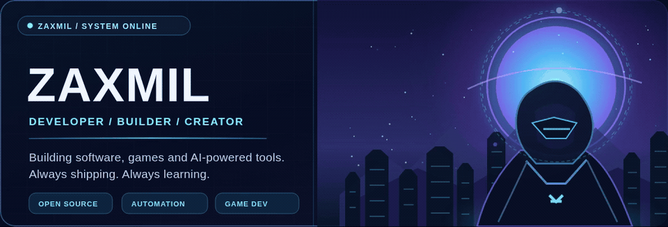
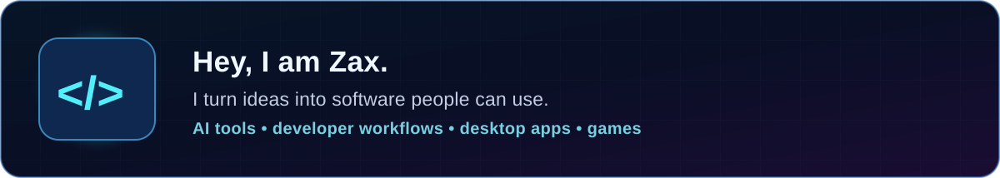
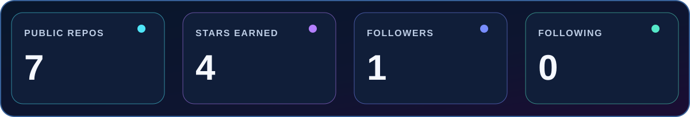
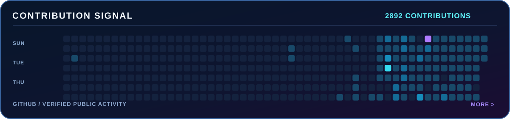
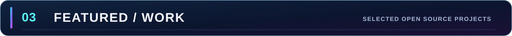
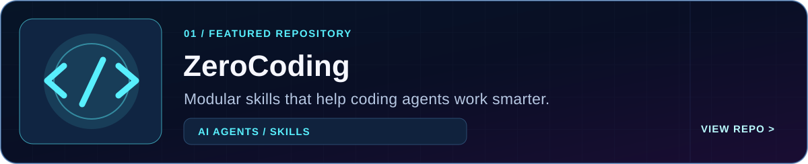
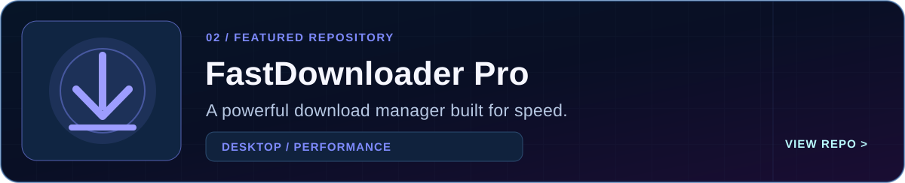
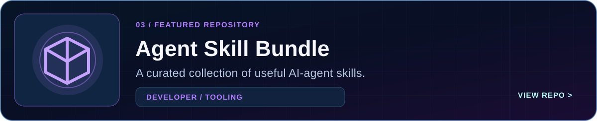
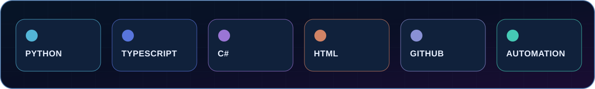
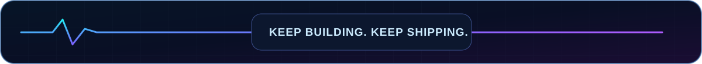

<!--
 ZAXMIL / ORIGINAL CYBERPUNK PROFILE
 Design and vector assets: handcrafted for this profile.
 SVG metrics generated with GitHub public API; no fabricated numbers.
-->

  

 

  <a href="https://github.com/ZaxMil?tab=repositories"><b>EXPLORE REPOSITORIES</b></a>
  &nbsp;&nbsp;·&nbsp;&nbsp;
  <a href="https://github.com/ZaxMil/ZeroCoding"><b>ZEROCODING</b></a>
  &nbsp;&nbsp;·&nbsp;&nbsp;
  <a href="https://github.com/ZaxMil/fast-downloader"><b>FASTDOWNLOADER</b></a>

 

 

Metrics are sourced from GitHub. The public profile and project data contain no private repository details. Graph reflects contributions visible to this profile; GitHub's privacy settings determine what can be displayed.

  

 

 

  <a href="https://github.com/ZaxMil?tab=repositories"><b>SEE ALL PUBLIC PROJECTS</b></a>

 

<!-- Animated hero: HyperFrames composition at motion/hero/index.html; non-animated fallback assets/hero-poster.png. -->

<!-- Maintenance:
Run GITHUB_TOKEN="$(gh auth token)" python3 scripts/update_profile.py to refresh local data.
GitHub Actions refreshes data when the workflow is enabled.
SVG design can be regenerated with python3 scripts/render_design.py.
-->
